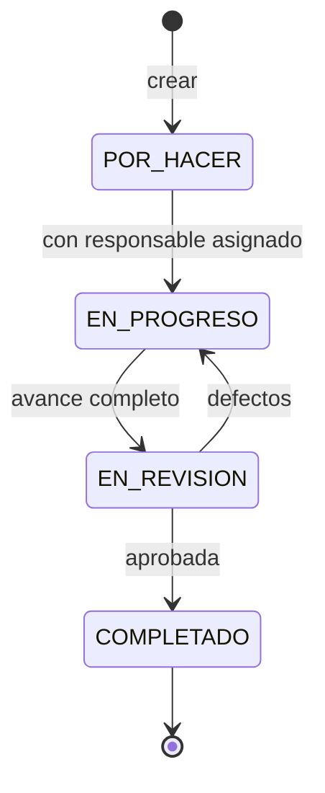

# API del Gestor de Tareas y Proyectos

Referencia de los endpoints del backend (Express + Prisma). Para probarlos a mano usa [`backend/api.http`](../backend/api.http); para las pruebas automatizadas, `npm test` en `backend/`.

- **URL base:** `http://localhost:3000/api`
- **Formato:** JSON en peticiones y respuestas (`Content-Type: application/json`).
- **Fechas:** se envían como texto ISO (`"2026-11-15"` o `"2026-11-15T14:00:00Z"`) y se devuelven en ISO UTC.

## Contenido

1. [Autenticación y roles](#1-autenticación-y-roles)
2. [Errores](#2-errores)
3. [Auth](#3-auth)
4. [Usuarios](#4-usuarios)
5. [Proyectos y dashboard](#5-proyectos-y-dashboard)
6. [Miembros](#6-miembros)
7. [Tableros](#7-tableros)
8. [Etiquetas](#8-etiquetas)
9. [Tareas](#9-tareas)
10. [Transiciones de estado](#10-transiciones-de-estado)
11. [Subtareas y checklist](#11-subtareas-y-checklist)
12. [Comentarios y bitácora](#12-comentarios-y-bitácora)

---

## 1. Autenticación y roles

Todos los endpoints, salvo los de `/auth` (excepto `/auth/perfil`) y `/health`, requieren el token JWT que devuelve el login:

```
Authorization: Bearer <token>
```

El token dura **8 horas**. El rol del usuario se consulta en la base en cada petición, así que un cambio de rol o la eliminación de un usuario aplica de inmediato aunque el token siga vigente.

Hay dos niveles de rol:

| Rol | Dónde vive | Qué permite |
|---|---|---|
| **ADMIN global** | `Usuario.rol` | Crear proyectos, gestionar usuarios. Actúa como ADMIN en **todos** los proyectos. |
| **MIEMBRO global** | `Usuario.rol` | Valor por defecto al registrarse. |
| **ADMIN de proyecto** | `ProyectoMiembro.rol` | Editar/eliminar el proyecto, gestionar miembros y tableros. No puede crear proyectos nuevos. |
| **MIEMBRO de proyecto** | `ProyectoMiembro.rol` | Ver el proyecto; crear, editar y mover tareas; subtareas, comentarios y etiquetas. |

En las tablas de cada sección, la columna **Permiso** usa:

- **Autenticado:** cualquier usuario con token.
- **Miembro:** miembro del proyecto (de cualquier rol) o ADMIN global.
- **ADMIN proyecto:** ADMIN del proyecto o ADMIN global.
- **ADMIN global:** solo `Usuario.rol = ADMIN`.

## 2. Errores

Todas las respuestas de error tienen la misma forma:

```json
{ "error": "La tarea debe tener un responsable asignado para pasar a EN_PROGRESO" }
```

El mensaje está en español y se puede mostrar directamente al usuario. Cuando una validación falla se informa el primer problema encontrado.

| Código | Cuándo |
|---|---|
| `400` | Datos inválidos, JSON mal formado o regla de negocio incumplida (p. ej. transición no permitida). |
| `401` | Falta el token, es inválido/expiró, o el usuario ya no existe. |
| `403` | Autenticado pero sin permiso (no es miembro, o no es ADMIN). |
| `404` | El recurso no existe, o no pertenece al padre indicado en la URL (p. ej. una subtarea de otra tarea). |
| `409` | Conflicto: correo ya registrado, miembro duplicado, etiqueta repetida, usuario con actividad. |
| `500` | Error inesperado (`"Error interno del servidor"`); el detalle queda solo en la consola del servidor. |

Las respuestas `204` no tienen cuerpo.

## 3. Auth

| Método | Ruta | Permiso | Descripción |
|---|---|---|---|
| POST | `/auth/registro` | Público | Crea un usuario MIEMBRO y devuelve token. |
| POST | `/auth/login` | Público | Devuelve token. |
| POST | `/auth/olvide-contrasena` | Público | Genera un token de recuperación (30 min). |
| POST | `/auth/restablecer-contrasena` | Público | Cambia la contraseña con el token de recuperación. |
| GET | `/auth/perfil` | Autenticado | Datos del usuario actual. |

**Reglas de contraseña:** mínimo 8 caracteres, al menos una mayúscula, una minúscula y un número.

**Registro**

```json
POST /auth/registro
{ "nombre": "Ana López", "email": "ana@demo.com", "password": "Clave123!" }
```

`201` (igual que el login) · `400` validación · `409` correo ya registrado.

**Login**

```json
POST /auth/login
{ "email": "ana@demo.com", "password": "Clave123!" }
```

```json
{
  "token": "eyJhbGciOi...",
  "usuario": { "id": 2, "nombre": "Ana López", "email": "ana@demo.com", "rol": "MIEMBRO" }
}
```

`401 Credenciales incorrectas` tanto si el correo no existe como si la contraseña es incorrecta.

**Recuperación de contraseña**

```json
POST /auth/olvide-contrasena
{ "email": "ana@demo.com" }
```

Responde siempre `200` con el mismo mensaje, exista o no el correo. **Por ahora el token se imprime en la consola del servidor** (`[reset] Token para ...`); el envío por correo está pendiente.

```json
POST /auth/restablecer-contrasena
{ "token": "<token de la consola>", "password": "NuevaClave456" }
```

`200` · `400` token inválido/expirado o contraseña débil. El token solo sirve una vez.

**Perfil:** `GET /auth/perfil` → `{ "id", "nombre", "email", "rol" }`.

## 4. Usuarios

| Método | Ruta | Permiso | Descripción |
|---|---|---|---|
| GET | `/usuarios?buscar=texto` | Autenticado | Lista/busca usuarios por nombre o correo. |
| GET | `/usuarios/:id` | ADMIN global | Detalle con proyectos y conteo de tareas. |
| POST | `/usuarios` | ADMIN global | Crea un usuario. |
| PUT | `/usuarios/:id` | ADMIN global | Edita nombre, email y/o rol. |
| DELETE | `/usuarios/:id` | ADMIN global | Elimina un usuario sin actividad. |

**Listar:** un MIEMBRO recibe solo `id`, `nombre` y `email` (sirve para elegir a quién agregar a un proyecto). El ADMIN recibe además `rol` y `creadoEn`.

**Crear**

```json
POST /usuarios
{ "nombre": "Carlos Ruiz", "email": "carlos@demo.com", "password": "Clave123!", "rol": "MIEMBRO" }
```

`rol` es opcional (por defecto `MIEMBRO`). `201` · `400` · `409` correo registrado.

**Editar:** `PUT /usuarios/:id` con cualquiera de `nombre`, `email`, `rol`.

**Reglas**

- Siempre debe quedar al menos un ADMIN global: degradarlo o eliminarlo responde `400`.
- Nadie puede eliminarse a sí mismo (`400`).
- Un usuario que creó proyectos o tareas, tiene tareas asignadas, comentó o aparece en la bitácora **no se puede eliminar** (`409`), para conservar la trazabilidad.

## 5. Proyectos y dashboard

| Método | Ruta | Permiso | Descripción |
|---|---|---|---|
| GET | `/proyectos` | Autenticado | Proyectos donde el usuario es miembro (ADMIN global: todos). |
| POST | `/proyectos` | ADMIN global | Crea un proyecto; el creador queda como ADMIN del proyecto. |
| GET | `/proyectos/:id` | Miembro | Detalle con miembros, tableros y etiquetas. |
| PUT | `/proyectos/:id` | ADMIN proyecto | Edita nombre y/o descripción. |
| DELETE | `/proyectos/:id` | ADMIN proyecto | Elimina el proyecto **con todos sus tableros, tareas, comentarios y bitácora**. |
| GET | `/proyectos/:id/dashboard` | Miembro | Resumen de tareas del proyecto. |

**Crear / editar**

```json
{ "nombre": "Sistema de Gestión Académica", "descripcion": "Opcional" }
```

**Listar** (`GET /proyectos`)

```json
[
  {
    "id": 1,
    "nombre": "Sistema de Gestión Académica",
    "descripcion": "Proyecto de ejemplo para la demostración.",
    "creadoEn": "2026-10-23T03:08:22.726Z",
    "creadorId": 1,
    "creador": { "id": 1, "nombre": "Admin Demo" },
    "_count": { "tableros": 1, "miembros": 4 },
    "miRol": "MIEMBRO"
  }
]
```

`miRol` es el rol del usuario actual en ese proyecto (`ADMIN` o `MIEMBRO`); úsalo para mostrar u ocultar acciones de gestión. `GET /proyectos/:id` también lo incluye, junto con `miembros`, `tableros` y `etiquetas`.

**Dashboard** (`GET /proyectos/:id/dashboard`)

```json
{
  "proyectoId": 1,
  "total": 6,
  "completadas": 1,
  "enProgreso": 3,
  "vencidas": 1,
  "porEstado": { "POR_HACER": 1, "EN_PROGRESO": 3, "EN_REVISION": 1, "COMPLETADO": 1 }
}
```

Una tarea está **vencida** si tiene `fechaLimite` anterior al momento actual y no está en COMPLETADO.

## 6. Miembros

| Método | Ruta | Permiso | Descripción |
|---|---|---|---|
| GET | `/proyectos/:id/miembros` | Miembro | Lista de miembros con su usuario. |
| POST | `/proyectos/:id/miembros` | ADMIN proyecto | Agrega un usuario existente. |
| PUT | `/proyectos/:id/miembros/:usuarioId` | ADMIN proyecto | Cambia el rol en el proyecto. |
| DELETE | `/proyectos/:id/miembros/:usuarioId` | ADMIN proyecto | Quita al usuario del proyecto. |

**Agregar** — por `usuarioId` o por `email`; `rol` opcional (`MIEMBRO` por defecto):

```json
POST /proyectos/1/miembros
{ "email": "luis@demo.com", "rol": "MIEMBRO" }
```

```json
{ "proyectoId": 1, "usuarioId": 3, "rol": "MIEMBRO", "usuario": { "id": 3, "nombre": "Luis Pérez", "email": "luis@demo.com" } }
```

`404` usuario no existe · `409` ya es miembro.

**Cambiar rol:** `PUT /proyectos/1/miembros/3` con `{ "rol": "ADMIN" }`.

**Reglas**

- El proyecto debe conservar al menos un ADMIN: quitar o degradar al último responde `400`.
- Al quitar a un miembro, sus tareas asignadas conservan el responsable (historial).

## 7. Tableros

| Método | Ruta | Permiso | Descripción |
|---|---|---|---|
| GET | `/proyectos/:id/tableros` | Miembro | Tableros del proyecto con sus columnas. |
| POST | `/proyectos/:id/tableros` | ADMIN proyecto | Crea un tablero con las 4 columnas de estado. |
| GET | `/tableros/:id` | Miembro | **Vista Kanban:** columnas ordenadas con sus tareas. |
| PUT | `/tableros/:id` | ADMIN proyecto | Renombra el tablero. |
| DELETE | `/tableros/:id` | ADMIN proyecto | Elimina el tablero **con todas sus tareas**. |

**Crear:** `{ "nombre": "Sprint 1" }`. Cada tablero nuevo trae estas columnas, que son las que entiende el control de estados:

| orden | nombre | tipo |
|---|---|---|
| 1 | Por hacer | `POR_HACER` |
| 2 | En progreso | `EN_PROGRESO` |
| 3 | En revisión / QA | `EN_REVISION` |
| 4 | Completado | `COMPLETADO` |

No hay endpoints para crear, renombrar o borrar columnas.

**Vista Kanban** (`GET /tableros/:id`)

```json
{
  "id": 1,
  "nombre": "Sprint 1",
  "proyectoId": 1,
  "creadoEn": "...",
  "columnas": [
    { "id": 1, "nombre": "Por hacer", "tipo": "POR_HACER", "orden": 1, "tableroId": 1, "tareas": [ /* Tarea */ ] },
    { "id": 2, "nombre": "En progreso", "tipo": "EN_PROGRESO", "orden": 2, "tableroId": 1, "tareas": [] }
  ]
}
```

Cada tarea tiene la misma forma que en [`GET /tareas/:id`](#objeto-tarea).

## 8. Etiquetas

| Método | Ruta | Permiso | Descripción |
|---|---|---|---|
| GET | `/proyectos/:id/etiquetas` | Miembro | Etiquetas del proyecto. |
| POST | `/proyectos/:id/etiquetas` | Miembro | Crea una etiqueta. |
| PUT | `/proyectos/:id/etiquetas/:etiquetaId` | Miembro | Edita nombre y/o color. |
| DELETE | `/proyectos/:id/etiquetas/:etiquetaId` | Miembro | Elimina la etiqueta y la quita de todas las tareas. |

```json
POST /proyectos/1/etiquetas
{ "nombre": "QA", "color": "#f59e0b" }
```

`color` es opcional (por defecto `#6366f1`) y debe tener formato `#rrggbb`. El nombre no puede repetirse en el mismo proyecto (`409`).

## 9. Tareas

| Método | Ruta | Permiso | Descripción |
|---|---|---|---|
| GET | `/tareas?tableroId=1` | Miembro | Tareas de un tablero (`tableroId` obligatorio). |
| POST | `/tareas` | Miembro | Crea una tarea en la columna POR_HACER del tablero. |
| GET | `/tareas/:id` | Miembro | Detalle completo. |
| PUT | `/tareas/:id` | Miembro | Edita campos (no el estado). |
| DELETE | `/tareas/:id` | Creador de la tarea o ADMIN proyecto | Elimina la tarea con subtareas, comentarios y bitácora. |
| PATCH | `/tareas/:id/mover` | Miembro | Cambia de estado; ver [sección 10](#10-transiciones-de-estado). |

**Crear**

```json
POST /tareas
{
  "tableroId": 1,
  "titulo": "Implementar login con JWT",
  "descripcion": "Opcional",
  "prioridad": "ALTA",
  "tipo": "TAREA",
  "responsableId": 3,
  "etiquetas": [1, 3],
  "fechaInicio": "2026-10-20",
  "fechaLimite": "2026-11-05"
}
```

| Campo | Obligatorio | Valores / reglas |
|---|---|---|
| `tableroId` | Sí | Tablero existente donde el usuario es miembro. |
| `titulo` | Sí | Texto no vacío, máx. 191 caracteres. |
| `descripcion` | No | Texto o `null`. |
| `prioridad` | No | `ALTA`, `MEDIA` (defecto), `BAJA`. |
| `tipo` | No | `TAREA` (defecto), `BUG`. |
| `responsableId` | No | Debe ser miembro del proyecto. `null` = sin responsable. |
| `etiquetas` | No | IDs de etiquetas **del mismo proyecto**. |
| `fechaInicio`, `fechaLimite` | No | Fechas válidas o `null`; `fechaLimite` ≥ `fechaInicio`. |

- La tarea siempre se crea en **POR_HACER**: no se puede crear directamente en otro estado.
- `fechaCreacion` se asigna automáticamente.
- La creación queda registrada en la bitácora (`CREADA`).

**Editar:** `PUT /tareas/:id` acepta los mismos campos que crear (todos opcionales, sin `tableroId`).

- Si envías `etiquetas`, **reemplaza** la lista completa.
- La coherencia de fechas se valida también contra las fechas ya guardadas.
- No se puede quitar el responsable (`responsableId: null`) a una tarea que ya salió de POR_HACER.

<a id="objeto-tarea"></a>
**Objeto tarea** (`GET /tareas/:id`; misma forma en listar, crear, editar, mover y Kanban)

```json
{
  "id": 2,
  "titulo": "Implementar login con JWT",
  "descripcion": "Registro, login y recuperación de contraseña.",
  "prioridad": "ALTA",
  "tipo": "TAREA",
  "orden": 0,
  "fechaCreacion": "2026-10-23T03:08:22.778Z",
  "fechaInicio": "2026-10-18T03:08:22.776Z",
  "fechaLimite": "2026-10-25T03:08:22.776Z",
  "fechaCierre": null,
  "columnaId": 3,
  "creadorId": 1,
  "responsableId": 3,
  "columna": { "id": 3, "nombre": "En revisión / QA", "tipo": "EN_REVISION", "tableroId": 1 },
  "responsable": { "id": 3, "nombre": "Luis Pérez", "email": "luis@demo.com" },
  "creador": { "id": 1, "nombre": "Admin Demo" },
  "etiquetas": [{ "id": 1, "nombre": "Backend", "color": "#2563eb", "proyectoId": 1 }],
  "subtareas": [
    { "id": 3, "titulo": "Endpoint de registro", "completada": true, "tareaId": 2, "checklist": [] },
    { "id": 5, "titulo": "Recuperar contraseña", "completada": false, "tareaId": 2, "checklist": [] }
  ],
  "vencida": false,
  "progreso": { "total": 3, "completadas": 2, "porcentaje": 67 }
}
```

- `columna.tipo` es el **estado actual** de la tarea.
- `vencida` usa el mismo criterio que el dashboard; sirve para pintar la tarjeta en rojo.
- `progreso.porcentaje` es el porcentaje de subtareas completadas (entero, `0` si no tiene subtareas).
- `fechaCierre` se llena al pasar a COMPLETADO.

## 10. Transiciones de estado

```
PATCH /tareas/:id/mover
{ "columnaDestinoId": 2 }
```

El backend decide si el movimiento es válido según el estado actual (`columna.tipo`) y el de la columna destino:



| Desde | Puede ir a | Condición |
|---|---|---|
| POR_HACER | EN_PROGRESO | La tarea debe tener `responsableId`. |
| EN_PROGRESO | EN_REVISION | — |
| EN_REVISION | COMPLETADO, EN_PROGRESO | — |
| COMPLETADO | *(ninguno)* | Estado final. Al entrar se llena `fechaCierre`. |

Respuestas:

- `200` con la [tarea actualizada](#objeto-tarea); se registra en la bitácora (`MOVIDA`, con `estadoAnterior` y `estadoNuevo`).
- `400` con mensaje claro en estos casos:
  - Sin responsable: `"La tarea debe tener un responsable asignado para pasar a EN_PROGRESO"`
  - Salto no permitido: `"Transición no permitida: POR_HACER → COMPLETADO. Desde POR_HACER solo se puede mover a: EN_PROGRESO"`
  - Desde COMPLETADO: `"La tarea está COMPLETADA: es un estado final y no se puede mover"`
  - Misma columna: `"La tarea ya está en el estado POR_HACER"`
  - Otro tablero: `"La columna destino debe pertenecer al mismo tablero"`
- `404` si la columna destino no existe.

**Para el frontend (drag & drop):** al soltar una tarjeta, llama a este endpoint y, si responde `400`, devuelve la tarjeta a su columna y muestra `error`. No hace falta replicar las reglas en el cliente.

## 11. Subtareas y checklist

Todas las rutas cuelgan de una tarea; el permiso es **Miembro** del proyecto de esa tarea. Una subtarea o item que no pertenece a la tarea/subtarea de la URL responde `404`.

| Método | Ruta | Descripción |
|---|---|---|
| GET | `/tareas/:id/subtareas` | Subtareas con su checklist. |
| POST | `/tareas/:id/subtareas` | `{ "titulo": "...", "completada": false }` (`completada` opcional). |
| PUT | `/tareas/:id/subtareas/:subtareaId` | Edita `titulo` y/o `completada`. |
| DELETE | `/tareas/:id/subtareas/:subtareaId` | Elimina la subtarea y su checklist. |
| POST | `/tareas/:id/subtareas/:subtareaId/checklist` | `{ "texto": "...", "completado": false }` (`completado` opcional). |
| PUT | `/tareas/:id/subtareas/:subtareaId/checklist/:itemId` | Edita `texto` y/o `completado`. |
| DELETE | `/tareas/:id/subtareas/:subtareaId/checklist/:itemId` | Elimina el item. |

Subtarea: `{ "id", "titulo", "completada", "tareaId", "checklist": [{ "id", "texto", "completado", "subtareaId" }] }`.

El porcentaje de la tarea padre (`progreso`) se calcula con `completada` de las subtareas; el checklist no influye en él.

## 12. Comentarios y bitácora

| Método | Ruta | Permiso | Descripción |
|---|---|---|---|
| GET | `/tareas/:id/comentarios` | Miembro | Comentarios en orden cronológico. |
| POST | `/tareas/:id/comentarios` | Miembro | `{ "texto": "..." }` |
| GET | `/tareas/:id/bitacora` | Miembro | Historial de actividad en orden cronológico. |

**Comentario**

```json
{ "id": 1, "texto": "Falta validar la fortaleza de la contraseña.", "creadoEn": "...", "tareaId": 2, "usuarioId": 1, "usuario": { "id": 1, "nombre": "Admin Demo" } }
```

**Registro de bitácora**

```json
{
  "id": 2,
  "accion": "MOVIDA",
  "detalle": "Por hacer → En progreso",
  "estadoAnterior": "POR_HACER",
  "estadoNuevo": "EN_PROGRESO",
  "fecha": "2026-10-18T03:08:22.843Z",
  "tareaId": 2,
  "usuarioId": 3,
  "usuario": { "id": 3, "nombre": "Luis Pérez" }
}
```

| `accion` | Cuándo | `estadoAnterior` / `estadoNuevo` |
|---|---|---|
| `CREADA` | Al crear la tarea | `null` / `POR_HACER` |
| `MOVIDA` | En cada cambio de estado | Estado de origen / destino |

La bitácora no se puede editar ni borrar desde la API; solo desaparece si se elimina la tarea.
